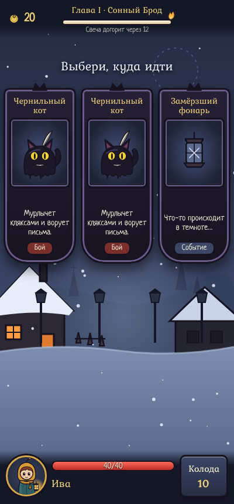

# Последний луч

Мобильная карточная rogue-like игра в духе зимней сказки на закате.

В Медовой Горке письма разносят до заката: когда садится солнце, из щелей выползают Тени и съедают недоставленные слова. Последнее письмо дня достаётся одному из четырёх героев на выбор, а адрес на нём на самом краю города. Путь длиной в 51 уровень: после каждого уровня солнце опускается ниже и фон немного меняется. Первая стадия проходит по городу, вторая по окраине, а на последнем уровне ждёт Король Теней.

<p>
  
  
  
</p>

## Как запустить

Сборка не нужна. Откройте `index.html` в браузере. На телефоне удобнее через любой статический сервер, например:

```sh
python3 -m http.server 8000
# затем откройте http://<ip-компьютера>:8000 с телефона
```

Игру можно выложить на GitHub Pages как есть.

## Правила

- **Герои.** Перед забегом выбирается один из четырёх героев. У каждого своё здоровье и монеты на старте, своя колода, особенность (талисман с начала забега) и три карты, которые выпадают только ему. Общие карты под его билд в наградах и лавке встречаются втрое чаще.

  | Герой | Билд | Особенность | Свои карты |
  |---|---|---|---|
  | Ива, фонарщица · 36 HP | Огоньки и Вспышки | Фонарь Ивы: после каждой Вспышки в лампе остаётся 1 Огонёк | Светлячок, Ламповое стекло, Ослепительный луч |
  | Тиша, скороход · 32 HP | Доставка и серии | Крылатые ботинки: каждая четвёртая карта за ход даёт +1 энергию и 1 карту | Срочно!, Экспресс, Срочная почта |
  | Марфа, сторожиха моста · 44 HP | Защита, Шипы и мороз | Окованный ставень: когда защита целиком принимает удар, враг получает 4 урона | Ледяная стена, Колючая изгородь, Стоять до утра |
  | Фома, трубочист · 38 HP | Поджог и частые удары | Закопчённая метла: каждый удар атак добавляет врагу Поджог 1 | Дымоход, Кочерга, Раздуть угли |

- **Сложность.** На экране выбора героя выбирается один из пяти уровней сложности. Выбор запоминается, а сохранение помнит сложность забега. Пройденные уровни отмечены галочкой.

  | Уровень | Здоровье врагов | Урон врагов | HP героя | Монеты за бои | Костёр лечит | После босса | Помехи в колоде |
  |---|---|---|---|---|---|---|---|
  | Прогулка | −25% | −20% | +12 | +25% | 40% | 70% | — |
  | Обычный маршрут | как задумано | как задумано | — | — | 30% | 50% | — |
  | Ранние сумерки | +15% | +10% | — | — | 30% | 40% | — |
  | Метель | +30% | +20% | −4 | −15% | 25% | 35% | Клякса |
  | Полярная ночь | +45% | +30% | −8 | −25% | 20% | 25% | Клякса, Недоставленное письмо |

- **Путь.** На каждом шаге выбираете одну из трёх карт-встреч: бой, элита, событие, лавка, сундук или костёр. Событий 8, среди них кузнец, почтовое отделение и ледяное зеркало.
- **Стадии.** 51 уровень. Уровни 1–25 — стадия I «Медовая Горка», уровни 26–50 — стадия II «Окраина», 51-й — финальный босс. На последнем уровне каждой стадии ждёт её босс. После босса стадии Ива восстанавливает половину HP и получает талисман.
- **Боссы.** На каждую стадию и на финал есть по три босса, в начале забега для каждой выбирается случайный:
  - стадия I — Сорока-Перехватчица, Сургучный Великан, Флюгер-Петух;
  - стадия II — Сумеречный Часовщик, Сумеречный Волк, Мостовой Тролль;
  - финал — Король Теней, Пустой Почтальон, Ночной Кит.
- **Фон.** После каждого уровня небо смещается от дневного к ночному: золотой час к концу первой стадии, закат на её границе, сумерки и ночь к финалу. В городе по одному зажигаются фонари, а на окраине с каждым шагом ближе дом адресата.
- **Бой.** 3 энергии и 5 карт за ход. Над врагом показано, что он сделает дальше. Защита сгорает в начале вашего хода.
- **Огонёк.** Каждый Огонёк добавляет атакам +2 урона. На трёх Огоньках лампа вспыхивает и бьёт врага на 8.
- **Механики карт.** Кроме Огоньков, в колоде работают:
  - **Решимость** — +1 урона каждой атаке за очко, до конца боя или до конца хода;
  - **Уязвим** — враг получает на 50% больше урона;
  - **Шипы** — враг ранит сам себя, когда бьёт героя;
  - **Мороз** — отнимает у врага Силу;
  - **Сон** — враг пропускает ход;
  - **Доставка** — эффект срабатывает в начале следующего хода;
  - **Серия** — карта сильнее за каждую карту, сыгранную до неё в этот ход;
  - **Удержание** — карта не сбрасывается в конце хода;
  - **Чары** — разыгрываются один раз и действуют до конца боя;
  - **Сгорает** — после розыгрыша карта уходит до конца боя.
  
  Всего 78 карт: 3 стартовые, 63 общие и по 3 карты у каждого героя. Справочник открывается из главного меню и из паузы, а нажатие на любой статус в бою показывает подсказку.
- **Редкость.** Карты и талисманы делятся на обычные, необычные и редкие. Редкость видна по камню на ярлыке карты (серый, синий, фиолетовый) и по цвету рамки талисмана.

  | | Обычные | Необычные | Редкие |
  |---|---|---|---|
  | Общие карты | 24 | 22 | 17 |
  | Талисманы | 18 | 12 | 13 |

  После обычного боя в награде чаще всего обычные карты (необычная 32%, редкая 8%), после элиты необычные (45% и 25%), после босса только необычные и редкие (40% и 60%). В лавке на прилавке по карте каждой редкости. Талисманы выпадают с весом 55 / 30 / 15 и стоят в лавке 90 / 108 / 125 монет.
- **Новые карты.** Среди них Копирка (повторяет предыдущую карту хода), Обратный адрес (возвращает в руку последние карты из сброса), До востребования (в следующий ход бесплатно разыгрывает верхние карты колоды), Лавина (урон за каждую карту в сбросе), Ночная смена (защита за неистраченную энергию) и Северное сияние (+1 энергия каждый ход).
- **Улучшение карт.** У костра, у кузнеца-снегиря и в лавке карту можно улучшить: растут числа или падает стоимость. Улучшенная карта отмечена плюсом.
- **Приёмы врагов.** Враги не только бьют и защищаются:
  - подкидывают в колоду помехи на время боя: Кляксу, Ледышку, Сургуч и Недоставленное письмо;
  - крадут монеты, которые возвращаются после победы;
  - лечатся;
  - отращивают колючки, которые ранят героя за каждый удар.

  У девяти врагов свой особый приём, он виден значком под именем:

  | Враг | Где | Приём |
  |---|---|---|
  | Матрёшка-Шкатулка | город | дважды раскрывается: вместо гибели выходит новая, поменьше |
  | Самовар-Кипяток | город | каждый пропущенный удар добавляет +1 урона его следующей атаке |
  | Кукушка из ходиков | город | каждая четвёртая карта за ход бьёт героя на 3; сбивает с ритма (−1 энергия) |
  | Туманница | окраина | туман: до её следующего хода любой удар по ней не больше 5 |
  | Ледяной Упырь | окраина | лечится на весь урон, прошедший сквозь защиту |
  | Шутиха | окраина | через три хода взрывается и исчезает; если победить раньше, есть достижение |
  | Ледяной Рыцарь | элита города | латы: его защита не сгорает и копится |
  | Метелица | элита окраины | заметает руку (−2 карты), насылает Хрупкость (защита −25%) и Ледышки |
  | Сторож с колотушкой | элита окраины | каждый ваш Навык даёт ему 3 защиты |
- **Талисманы.** 43 обычных, необычных и редких талисмана дают элиты, сундуки, события и лавка. После босса стадии можно выбрать один из трёх трофеев босса. Их 6, и они сильно меняют правила: например, +1 энергия ценой меньшей руки или вспышка на двух Огоньках, но без усиления атак.
- **Противники.** У каждой стадии свой набор: в городе 12 обычных врагов и 3 элиты, на окраине 11 обычных и 5 элит. Недавно встреченные враги и те, что были на прошлом шаге, не выпадают снова, а остальные выпадают тем реже, чем чаще уже встречались.
- **Звук.** Музыка и звуки синтезируются в браузере, без файлов: свои пьесы для меню, города, окраины, финальной ночи, боя и битвы с боссом. Включаются после первого касания.
- **Настройки.** Шестерёнка в правом верхнем углу (а также кнопки в главном меню и в паузе) открывает окно настроек:
  - громкость звуков и музыки ползунками;
  - показывать или пропускать вступление;
  - обычные или быстрые анимации;
  - снегопад включён или выключен, без него меньше расход заряда;
  - розыгрыш карты в одно или два касания;
  - достижения, справочник, статистика забегов и сброс прогресса.
  
  Настройки, статистика и громкость хранятся в браузере.
- **Достижения.** 80 достижений в трёх разделах: Путь, Мастерство и Коллекция. Панель открывается из главного меню и из настроек.
  - Наверху общий прогресс, внизу вкладки разделов.
  - У каждого достижения есть портрет, название, описание с прогрессом вида «820/1 000» и полоска до цели.
  - Полученные отмечены почтовым штемпелем «Получено» с датой, а свежие — меткой «новое».
  - Накопительные цели идут ступенями ★, ★★ и ★★★: потраченные монеты, Вспышки, сыгранные карты, победы и другие.
  - Разовые цели: доставить письмо каждым героем и на каждой сложности, победить каждого из 9 боссов, выиграть бой без потери HP или за один ход, добить врага Поджогом или Шипами, усыпить босса, сыграть 8 карт за ход и другие.
  - Когда достижение открывается, сверху появляется плашка со звуком штемпеля. Прогресс хранится в браузере, сброс в настройках стирает и его.
- **Главное меню и сохранение.** В главном меню можно продолжить забег, начать новый или открыть справочник. Забег сохраняется в браузере после каждого уровня, а также в лавке, на экране награды и при выборе трофея. Кнопка меню в правом верхнем углу ставит игру на паузу и выводит в главное меню. Если выйти посреди боя, при продолжении этот бой начнётся заново. Поражение или победа стирают сохранение.
- **Управление.** Тап по карте выбирает её, второй тап разыгрывает. Колода и сброс открываются по нажатию.

## Устройство

| Файл | Что внутри |
|---|---|
| `index.html` | Каркас страницы |
| `css/style.css` | Стили. Логический экран 400×860 масштабируется под устройство |
| `js/art.js` | Вся графика: персонажи, иконки карт и фон нарисованы SVG-кодом |
| `js/data.js` | Карты, враги, талисманы и события. Баланс правится здесь |
| `js/audio.js` | Музыка и звуковые эффекты на Web Audio API |
| `js/story.js` | Сюжет, стадии пути и время суток: тексты, боссы стадий и ключевые кадры неба |
| `js/achievements.js` | Список достижений: названия, цели, ступени и портреты |
| `js/game.js` | Логика забега и боя, отрисовка экранов |

Новую карту можно добавить одной записью в `CARDS` в `js/data.js`: в описании и розыгрыше флаг `u` означает улучшенную версию. Новый талисман добавляется записью в `RELICS`, а его эффект вписывается в нужное место боя в `js/game.js`. Новое событие добавляется одной записью в `EVENTS`. Нового врага или босса можно добавить в `ENEMIES`, нарисовать в `js/art.js` и вписать в списки `early`, `normals`, `elites` или `boss` нужной стадии в `js/story.js`. Новое достижение добавляется одной строкой в `js/achievements.js`. Если ему нужен новый счётчик, его увеличивает вызов `ach.add`, `ach.max`, `ach.flag` или `ach.put` в нужном месте `js/game.js`.

## Сюжет и время суток

Тексты сюжета и палитры неба лежат в `js/story.js`. Активный сюжет задаёт `ACTIVE_STORY`. Первая версия, ночная история «Фитиль» про Ночную Моль, сохранена там же. Посмотреть другие варианты неба можно, дописав к адресу `#night`, `#day` или `#dawn`.
