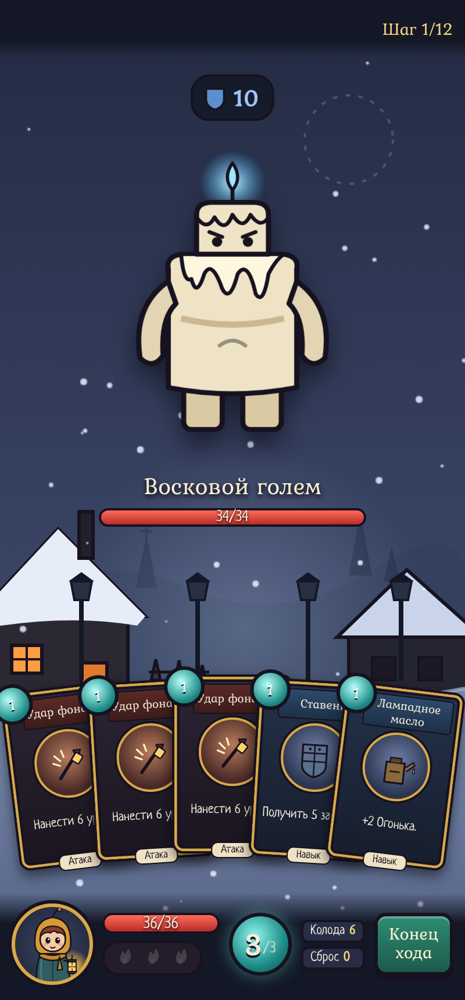

# Последний луч

Мобильная карточная rogue-like игра в духе зимней сказки на закате.

В Медовой Горке письма разносят до заката: когда садится солнце, из щелей выползают Тени и съедают недоставленные слова. Последнее письмо дня достаётся одному из восьми героев на выбор, а адрес на нём на самом краю города. Путь длиной в 51 уровень: после каждого уровня солнце опускается ниже и фон немного меняется. Первая стадия проходит по городу, вторая по окраине, а на последнем уровне ждёт Король Теней.

<p>
  
  
  
</p>

## Как запустить

Сборка не нужна. Откройте `index.html` в браузере. На телефоне удобнее через любой статический сервер, например:

```sh
python3 -m http.server 8000
# затем откройте http://<ip-компьютера>:8000 с телефона
```

Игру можно выложить на GitHub Pages как есть.

## Правила

- **Герои.** Перед забегом выбирается один из восьми героев. У каждого своё здоровье и монеты на старте, своя колода, особенность (талисман с начала забега), карты и один талисман, которые выпадают только ему. Общие карты под его билд в наградах и лавке встречаются втрое чаще. Четыре новых героя играют через свои механики: Пряники, Заточку, пса Дружка и Цену здоровьем. Луша, Савва и Ульяна открываются покупкой в магазине, остальные пять бесплатные.

  | Герой | Билд | Особенность | Свои карты |
  |---|---|---|---|
  | Ива, фонарщица · 36 HP | Огоньки и Вспышки | Фонарь Ивы: после каждой Вспышки в лампе остаётся 1 Огонёк | Светлячок, Ламповое стекло, Ослепительный луч |
  | Тиша, скороход · 32 HP | Доставка и серии | Крылатые ботинки: каждая четвёртая карта за ход даёт +1 энергию и 1 карту | Срочно!, Экспресс, Срочная почта |
  | Марфа, сторожиха моста · 44 HP | Защита, Шипы и мороз | Окованный ставень: когда защита целиком принимает удар, враг получает 4 урона | Ледяная стена, Колючая изгородь, Стоять до утра |
  | Фома, трубочист · 38 HP | Поджог и частые удары | Закопчённая метла: каждый удар атак добавляет врагу Поджог 1 | Дымоход, Кочерга, Раздуть угли |
  | Груня, пряничница · 36 HP | Пряники и быстрые ходы | Расписная формочка: в начале каждого хода в руку ложится Пряник | Замесить тесто, Скалка, Сахарная глазурь, Пряничный терем, Ярмарка |
  | Савва, точильщик · 40 HP | Заточка и Решимость | Точильный круг: в начале каждого хода одна карта в руке затачивается | Править лезвие, Искры из-под круга, Оселок, Подмастерье, Звон стали |
  | Луша, пастушка · 36 HP | Верный пёс и команды | Пёс Дружок: в конце каждого хода кусает врага на свою Злость (в начале боя 3) | Взять!, Рядом!, Сахарная косточка, Волкодав, Вой на луну |
  | Ульяна, знахарка · 44 HP | Цена здоровья и травы | Ступка знахарки: когда платите Цену, враг получает столько же урона | Горький корень, Ромашковый отвар, Полынь, Сон-трава, Живая вода |

  Талисманы героя: Щипцы для фитиля (Ива), Верстовой столб (Тиша), Перила моста (Марфа), Колпак на трубу (Фома), Горшочек мёда (Груня), Ремень для правки (Савва), Ошейник с бубенцом (Луша), Мешочек трав (Ульяна).

- **Сложность.** На экране выбора героя выбирается один из пяти уровней сложности. Выбор запоминается, а сохранение помнит сложность забега. Пройденные уровни отмечены галочкой.

  | Уровень | Здоровье врагов | Урон врагов | HP героя | Монеты за бои | Костёр лечит | После босса | Помехи в колоде |
  |---|---|---|---|---|---|---|---|
  | Прогулка | −25% | −20% | +12 | +25% | 40% | 70% | — |
  | Обычный маршрут | как задумано | как задумано | — | — | 30% | 50% | — |
  | Ранние сумерки | +15% | +10% | — | — | 30% | 40% | — |
  | Метель | +30% | +20% | −4 | −15% | 25% | 35% | Клякса |
  | Полярная ночь | +45% | +30% | −8 | −25% | 20% | 25% | Клякса, Недоставленное письмо |

- **Путь.** На каждом шаге выбираете одну из трёх карт-встреч: бой, элита, событие, лавка, сундук или костёр. Событий 8, среди них кузнец, почтовое отделение и ледяное зеркало.
- **Стадии.** 51 уровень. Уровни 1–25 — стадия I «Медовая Горка», уровни 26–50 — стадия II «Окраина», 51-й — финальный босс. На последнем уровне каждой стадии ждёт её босс. После босса стадии герой восстанавливает половину HP и получает талисман.
- **Боссы.** На каждую стадию и на финал есть по три босса, в начале забега для каждой выбирается случайный:
  - стадия I — Сорока-Перехватчица, Сургучный Великан, Флюгер-Петух;
  - стадия II — Сумеречный Часовщик, Сумеречный Волк, Мостовой Тролль;
  - финал — Король Теней, Пустой Почтальон, Ночной Кит.
- **Фон.** После каждого уровня небо смещается от дневного к ночному: золотой час к концу первой стадии, закат на её границе, сумерки и ночь к финалу. В городе по одному зажигаются фонари, а на окраине с каждым шагом ближе дом адресата.
- **Бой.** 3 энергии и 5 карт за ход. Над врагом показано, что он сделает дальше. Защита сгорает в начале вашего хода.
- **Огонёк.** Каждый Огонёк добавляет атакам +2 урона. На трёх Огоньках лампа вспыхивает и бьёт врага на 8.
- **Механики карт.** Кроме Огоньков, в колоде работают:
  - **Решимость** — +1 урона каждой атаке за очко, до конца боя или до конца хода;
  - **Уязвим** — враг получает на 50% больше урона;
  - **Шипы** — враг ранит сам себя, когда бьёт героя;
  - **Мороз** — отнимает у врага Силу;
  - **Сон** — враг пропускает ход;
  - **Доставка** — эффект срабатывает в начале следующего хода;
  - **Серия** — карта сильнее за каждую карту, сыгранную до неё в этот ход;
  - **Удержание** — карта не сбрасывается в конце хода;
  - **Чары** — разыгрываются один раз и действуют до конца боя;
  - **Сгорает** — после розыгрыша карта уходит до конца боя;
  - **Пряник** — карта за 0 энергии, которую пряничница печёт прямо в бою: бьёт на 3 и даёт 3 защиты, потом сгорает;
  - **Заточка** — карта улучшается до конца боя, после боя снова обычная;
  - **Дружок** — пёс пастушки кусает врага в конце хода на свою Злость, команды делают его злее;
  - **Цена** — чтобы сыграть карту, нужно отдать столько HP; последние HP отдать нельзя.
  
  Всего 107 карт: 3 стартовые, 71 общая, по 3 карты у первых четырёх героев, по 5 у новых и Пряник. Справочник открывается из главного меню и из паузы, а нажатие на любой статус в бою показывает подсказку.
- **Редкость.** Карты и талисманы делятся на пять редкостей. Редкость видна по камню на ярлыке карты и по цвету рамки: обычные серые, необычные зелёные, редкие синие, эпические фиолетовые, легендарные золотые и светятся. Легендарную карту можно взять в колоду только одну.

  | | Обычные | Необычные | Редкие | Эпические | Легендарные |
  |---|---|---|---|---|---|
  | Общие карты | 24 | 22 | 12 | 9 | 4 |
  | Талисманы | 18 | 12 | 8 | 8 | 3 |
  | Карты героев | 16 | 4 | 8 | 4 | — |
  | Талисманы героев | — | 7 | 1 | — | — |

  Шансы карт в награде:

  | Где | Необычная | Редкая | Эпическая | Легендарная |
  |---|---|---|---|---|
  | Обычный бой | 32% | 8% | 3% | — |
  | Элита | 40% | 23% | 10% | 2% |
  | Босс | — | 60% | 30% | 10% |

  В лавке на прилавке обычная, необычная и редкая карты, а третья иногда эпическая (20%) или легендарная (5%). Талисманы выпадают с весом 55 / 30 / 15 / 6 / 2 и стоят в лавке 90 / 108 / 125 / 150 / 190 монет.
- **Легендарные карты.** Бой курантов (до конца хода все карты бесплатны), Последний луч (30 урона и Вспышка), Перо Жар-птицы (каждый ход +2 Огонька и Поджог 3), Вечная зима (каждый ход враг слабеет, а герой получает 8 защиты).
- **Легендарные талисманы.** Солнечный камень (+1 энергия и +1 карта каждый ход), Последняя свеча (один раз за забег спасает от гибели), Заговорённая сумка (карты не сбрасываются в конце хода).
- **Новые карты.** Среди них Копирка (повторяет предыдущую карту хода), Обратный адрес (возвращает в руку последние карты из сброса), До востребования (в следующий ход бесплатно разыгрывает верхние карты колоды), Лавина (урон за каждую карту в сбросе), Ночная смена (защита за неистраченную энергию) и Северное сияние (+1 энергия каждый ход).
- **Улучшение карт.** У костра, у кузнеца-снегиря и в лавке карту можно улучшить: растут числа или падает стоимость. Улучшенная карта отмечена плюсом.
- **Приёмы врагов.** Враги не только бьют и защищаются:
  - подкидывают в колоду помехи на время боя: Кляксу, Ледышку, Сургуч и Недоставленное письмо;
  - крадут монеты, которые возвращаются после победы;
  - лечатся;
  - отращивают колючки, которые ранят героя за каждый удар.

  У девяти врагов свой особый приём, он виден значком под именем:

  | Враг | Где | Приём |
  |---|---|---|
  | Матрёшка-Шкатулка | город | дважды раскрывается: вместо гибели выходит новая, поменьше |
  | Самовар-Кипяток | город | каждый пропущенный удар добавляет +1 урона его следующей атаке |
  | Кукушка из ходиков | город | каждая четвёртая карта за ход бьёт героя на 3; сбивает с ритма (−1 энергия) |
  | Туманница | окраина | туман: до её следующего хода любой удар по ней не больше 5 |
  | Ледяной Упырь | окраина | лечится на весь урон, прошедший сквозь защиту |
  | Шутиха | окраина | через три хода взрывается и исчезает; если победить раньше, есть достижение |
  | Ледяной Рыцарь | элита города | латы: его защита не сгорает и копится |
  | Метелица | элита окраины | заметает руку (−2 карты), насылает Хрупкость (защита −25%) и Ледышки |
  | Сторож с колотушкой | элита окраины | каждый ваш Навык даёт ему 3 защиты |
- **Талисманы.** 57 талисманов пяти редкостей дают элиты, сундуки, события и лавка, из них 8 выпадают только своему герою. После босса стадии можно выбрать один из трёх трофеев босса. Их 6, и они сильно меняют правила: например, +1 энергия ценой меньшей руки или вспышка на двух Огоньках, но без усиления атак.
- **Противники.** У каждой стадии свой набор: в городе 12 обычных врагов и 3 элиты, на окраине 11 обычных и 5 элит. Недавно встреченные враги и те, что были на прошлом шаге, не выпадают снова, а остальные выпадают тем реже, чем чаще уже встречались.
- **Бой.** Карту можно вытянуть из руки пальцем вверх и отпустить над полем: она сыграет. Как и раньше, её можно сыграть двумя касаниями (или одним, если так выбрано в настройках). Когда начинается бой, камера опускается к земле, и враг стоит на снегу.
- **Анимации приёмов.** У каждого приёма своя анимация и свой звук: огонь охватывает врага и трещит, Дружок прыгает и кусает с лаем, мороз покрывает врага инеем, штемпель ставит оттиск, письмо летит конвертом, сосулька разбивается, снежок лопается облаком снега, а звездопад и луч бьют сверху. Защита, лечение, Решимость, Шипы, энергия, Заточка, Пряники и Цена тоже показаны своими эффектами. Когда срабатывает талисман, над героем или врагом всплывает его значок с названием.
- **Звук.** Музыка и звуки синтезируются в браузере, без файлов: свои пьесы для меню, города, окраины, финальной ночи, боя и битвы с боссом. Включаются после первого касания.
- **Настройки.** Шестерёнка в правом верхнем углу (а также кнопки в главном меню и в паузе) открывает окно настроек:
  - громкость звуков и музыки ползунками;
  - показывать или пропускать вступление;
  - обычные или быстрые анимации;
  - снегопад включён или выключен, без него меньше расход заряда;
  - розыгрыш карты в одно или два касания;
  - достижения, справочник, статистика забегов и сброс прогресса.
  
  Настройки, статистика и громкость хранятся в браузере.
- **Достижения.** 90 достижений в трёх разделах: Путь, Мастерство и Коллекция. Панель открывается из главного меню и из настроек.
  - Наверху общий прогресс, внизу вкладки разделов.
  - У каждого достижения есть портрет, название, описание с прогрессом вида «820/1 000» и полоска до цели.
  - Полученные отмечены почтовым штемпелем «Получено» с датой, а свежие — меткой «новое».
  - Накопительные цели идут ступенями ★, ★★ и ★★★: потраченные монеты, Вспышки, сыгранные карты, победы и другие.
  - Разовые цели: доставить письмо каждым героем и на каждой сложности, победить каждого из 9 боссов, выиграть бой без потери HP или за один ход, добить врага Поджогом или Шипами, усыпить босса, сыграть 8 карт за ход и другие.
  - Когда достижение открывается, сверху появляется плашка со звуком штемпеля. Прогресс хранится в браузере, сброс в настройках стирает и его.
- **Главное меню и сохранение.** В главном меню можно продолжить забег, начать новый или открыть справочник. Забег сохраняется в браузере после каждого уровня, а также в лавке, на экране награды и при выборе трофея. Кнопка меню в правом верхнем углу ставит игру на паузу и выводит в главное меню. Если выйти посреди боя, при продолжении этот бой начнётся заново. Поражение или победа стирают сохранение.
- **Управление.** Тап по карте выбирает её, второй тап разыгрывает. Колода и сброс открываются по нажатию.
- **Магазин.** Открывается из главного меню. В нём три платных героя (Луша, Савва, Ульяна) по одному или набором, и режим без рекламы. Платные герои на экране выбора отмечены замком, их можно открыть прямо там. Есть «Восстановить покупки». Цены в долларах и условные: $1.99 за героя, $3.99 за троих, $2.99 без рекламы.
- **Реклама.** Только по желанию игрока, за награду:
  - в четырёх событиях есть вариант с повышенной наградой за просмотр (колодец, кукольник, кошелёк, кузнец);
  - событие «Балаган на площади» целиком рекламное: талисман и монеты за просмотр;
  - после поражения в бою можно начать этот бой заново (с HP и колодой, что были перед ним) или вернуться на развилку перед боем, либо закончить забег.

  В режиме без рекламы те же награды и возрождения выдаются сразу, без ролика. Если закрыть ролик раньше, награды нет.
- **Языки.** Английский, русский и украинский. При первом запуске игра берёт язык телефона: русский или украинский, а для любого другого английский. Сменить язык можно в настройках, игра при этом перезагружается, а забег сохраняется. Для проверки язык можно задать в адресе: `?lang=en`, `?lang=ru` или `?lang=uk`.
- **Покупки и реклама в прототипе.** Сейчас это заглушки: покупка открывается после подтверждения без оплаты, а вместо ролика пятисекундный экран. Для релиза в `js/store.js` нужно заменить две функции, `realBuy` и `realAd`, вызовами SDK площадки (Google Play Billing, RuStore, App Store, Яндекс Игры, AdMob и т. п.). Остальная игра обращается только к `window.Store`. Купленное хранится отдельно и не стирается сбросом прогресса. Платные герои задаются полем `paid: true` в `CLASSES`. Цели достижений «собрать все карты и талисманы» не требуют покупок.

## Устройство

| Файл | Что внутри |
|---|---|
| `index.html` | Каркас страницы |
| `css/style.css` | Стили. Логический экран 400×860 масштабируется под устройство |
| `js/i18n.js` | Языки: выбор языка, подстановка чисел, формы слов по числу и по полу героя |
| `js/lang/en.js`, `js/lang/uk.js` | Переводы на английский и украинский. Ключ строки — русский текст из кода, карты, враги, талисманы, события, герои, сюжет и достижения переводятся по id |
| `js/art.js` | Вся графика: персонажи, иконки карт и фон нарисованы SVG-кодом |
| `js/data.js` | Карты, враги, талисманы и события. Баланс правится здесь |
| `js/store.js` | Магазин и реклама за награду: товары, цены, покупки. Заглушки для прототипа, сюда подключается SDK площадки |
| `js/audio.js` | Музыка и звуковые эффекты на Web Audio API |
| `js/fx.js` | Анимации карт и талисманов в бою: эффекты, снаряды, частицы и значки сработавших талисманов |
| `js/story.js` | Сюжет, стадии пути и время суток: тексты, боссы стадий и ключевые кадры неба |
| `js/achievements.js` | Список достижений: названия, цели, ступени и портреты |
| `js/game.js` | Логика забега и боя, отрисовка экранов |

Новую карту можно добавить одной записью в `CARDS` в `js/data.js`: в описании и розыгрыше флаг `u` означает улучшенную версию. Новый талисман добавляется записью в `RELICS`, а его эффект вписывается в нужное место боя в `js/game.js`. Новое событие добавляется одной записью в `EVENTS`. Нового врага или босса можно добавить в `ENEMIES`, нарисовать в `js/art.js` и вписать в списки `early`, `normals`, `elites` или `boss` нужной стадии в `js/story.js`. Новое достижение добавляется одной строкой в `js/achievements.js`. Новый текст в коде оборачивается в `tr('…')`, а его перевод добавляется в `js/lang/en.js` и `js/lang/uk.js`. Для новой карты, врага или талисмана перевод добавляется в разделы `cards`, `enemies` и `relics` тех же файлов, а описание карты повторяет русскую формулу с теми же числами. Если ему нужен новый счётчик, его увеличивает вызов `ach.add`, `ach.max`, `ach.flag` или `ach.put` в нужном месте `js/game.js`.

## Сюжет и время суток

Тексты сюжета и палитры неба лежат в `js/story.js`. Активный сюжет задаёт `ACTIVE_STORY`. Первая версия, ночная история «Фитиль» про Ночную Моль, сохранена там же. Посмотреть другие варианты неба можно, дописав к адресу `#night`, `#day` или `#dawn`.
